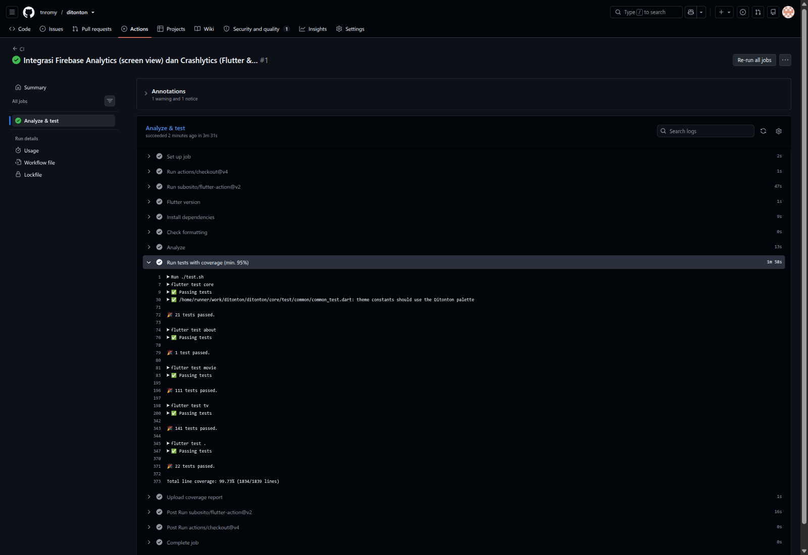
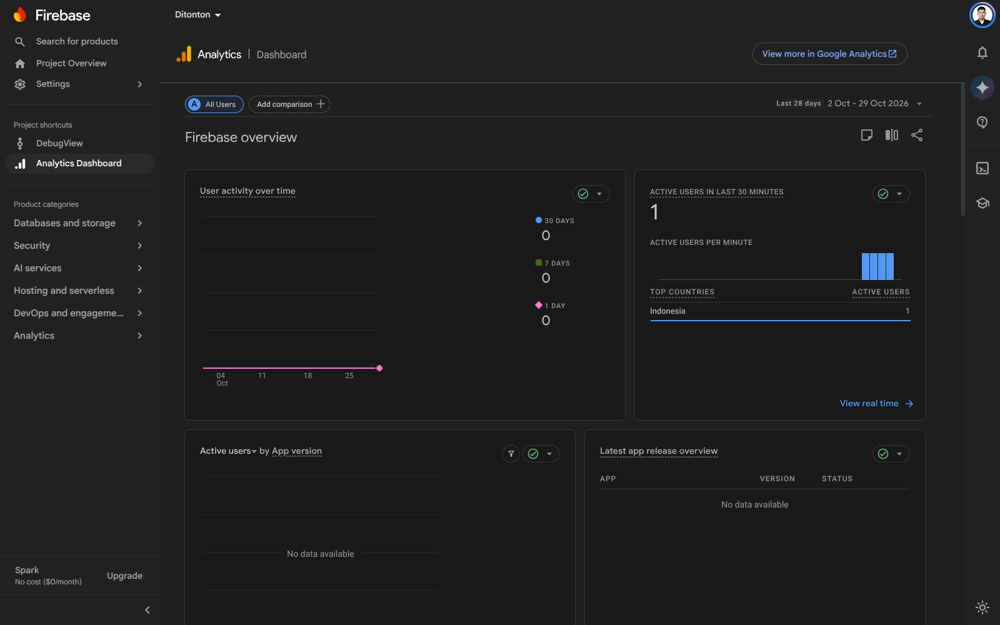
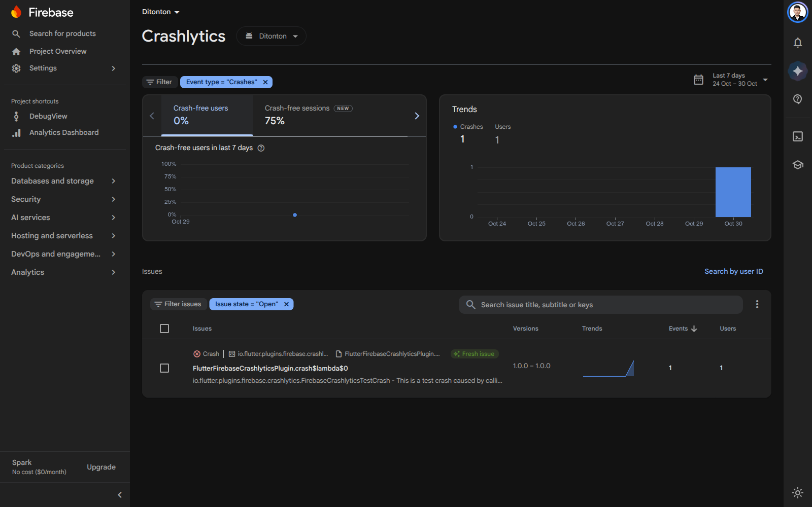

# Ditonton

[](https://github.com/tnromy/ditonton/actions/workflows/ci.yml)

A Flutter application for browsing and bookmarking **Movies** and **TV Series** from [The Movie Database (TMDB)](https://www.themoviedb.org/). Built with Clean Architecture, modular packages, BLoC state management, SSL pinning, and Firebase integration.

## Features

- **Movies**: Now Playing, Popular, Top Rated, detail with recommendations, and search
- **TV Series**: On The Air, Popular, Top Rated, detail with recommendations, and search
- **Season & Episode**: browse all seasons and episodes for any TV series
- **Watchlist**: save movies and TV series to local SQLite database with tabbed view
- **SSL Pinning**: certificate pinning for all TMDB API requests
- **Firebase Analytics**: automatic screen view tracking
- **Firebase Crashlytics**: Flutter and uncaught error reporting
- **CI/CD**: GitHub Actions for format check, static analysis, and test coverage

## Architecture

Clean Architecture (data → domain → presentation) organized as a **pub workspace** with modular packages:

```
┌──────────────────────────────────────────────┐
│  lib/  (main app: DI, routing, watchlist, FB) │
├──────────────────────────────────────────────┤
│  movie/     │  tv/        │  about/          │
│  (full MVC) │  (full MVC) │  (info page)     │
├──────────────────────────────────────────────┤
│  core/  (theme, routes, DB, HTTP, SSL, shared)│
└──────────────────────────────────────────────┘
```

| Module | Contents |
|--------|---------|
| `core/` | Theme, route names, `DatabaseHelper` (SQLite), HTTP client with SSL pinning, `Failure` classes, shared widgets |
| `movie/` | Movies feature: data sources, repositories, use cases, BLoC, pages, and tests |
| `tv/` | TV Series feature with Season & Episode support |
| `about/` | About page |
| `lib/` | App entry point, `get_it` dependency injection, routing, Watchlist tabs, Firebase setup |

**State management**: BLoC (`flutter_bloc`) with `rxdart` for search debouncing.

## SSL Pinning

All requests to `api.themoviedb.org` go through `SslPinning.createClient()` which uses a custom `SecurityContext` trusting only **Amazon Root CA 1** (`core/certificates/amazon_root_ca_1.pem`). Any server with a different certificate chain fails at the TLS handshake.

## Getting Started

```bash
flutter pub get
flutter run
```

## Testing

```bash
# Unit & widget tests (all modules) + combined coverage report (95%+ target)
./test.sh

# Integration tests on a connected device/emulator
flutter test integration_test -d <device>
```

## CI

GitHub Actions runs `dart format --set-exit-if-changed`, `flutter analyze`, and `./test.sh` on every push.

## Screenshots

| CI (GitHub Actions) | Firebase Analytics | Firebase Crashlytics |
|---|---|---|
|  |  |  |

## Tech Stack

- **Flutter** / Dart
- **BLoC** (`flutter_bloc`) + RxDart
- **SQLite** (`sqflite`) for local persistence
- **SSL Pinning** (custom SecurityContext)
- **Firebase** Analytics & Crashlytics
- **GitHub Actions** CI
- **Clean Architecture** with modular packages
- **TMDB API** for movie and TV data

## License

MIT
